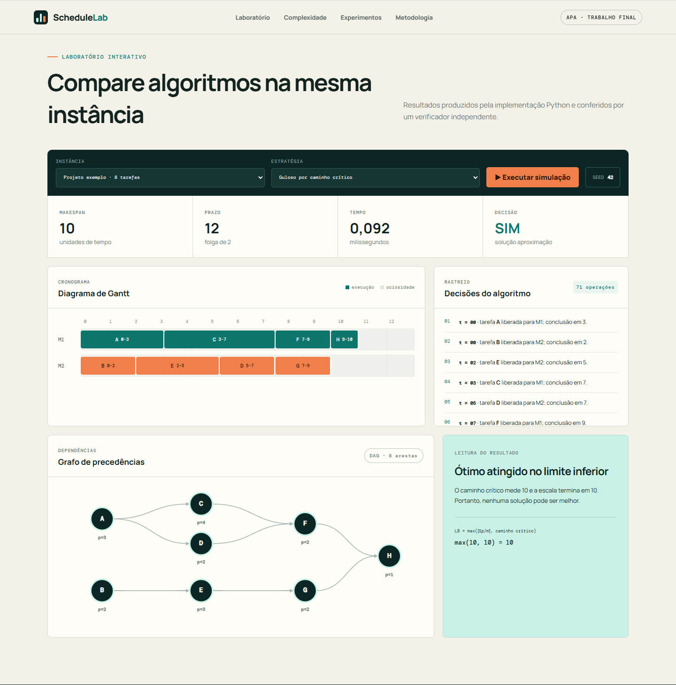
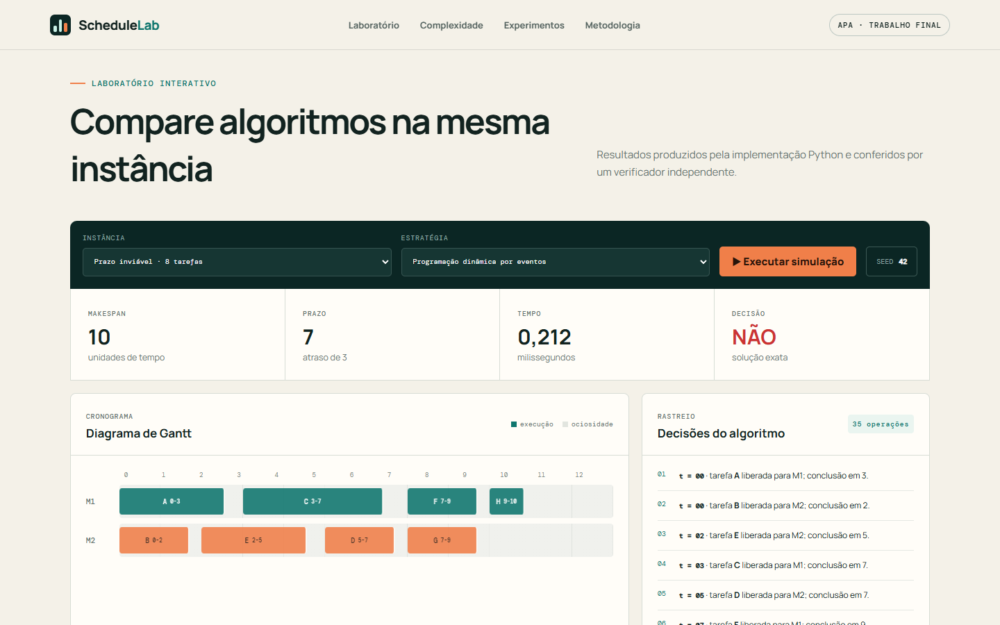
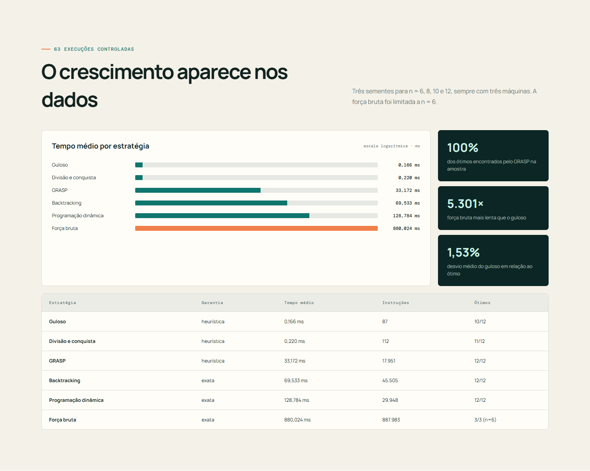
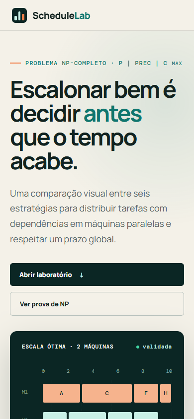

<div align="center">

# ScheduleLab

### Laboratório interativo de Escalonamento de Tarefas

Uma implementação acadêmica, reproduzível e visual do problema **`P|prec|Cmax`**,
comparando seis paradigmas de projeto de algoritmos.


</div>


## Sobre o projeto

O ScheduleLab estuda como tarefas com durações e relações de precedência podem
ser distribuídas entre máquinas paralelas idênticas, sem preempção, minimizando
o tempo de conclusão total (*makespan*). Além da implementação em Python usada
nos experimentos científicos, o projeto oferece um laboratório web que executa
novas instâncias aleatórias **ao vivo no navegador**.

A aplicação permite alterar o algoritmo e gerar um caso novo a cada clique. Os
parâmetros, o DAG de precedências, o escalonamento, o gráfico de Gantt, as
métricas e o rastreio são recalculados na hora — não são animações ou resultados
pré-gravados.

### O que está incluído

- seis estratégias: força bruta, backtracking, divisão e conquista, programação
  dinâmica, guloso e GRASP;
- instâncias aleatórias executadas no navegador e casos fixos reproduzíveis;
- gráfico de Gantt, DAG de precedências, métricas e rastreio da execução;
- verificador independente de validade das soluções;
- contagem instrumentada de operações e medição de tempo;
- benchmark controlado, testes automatizados e documentação acadêmica;
- prova de pertinência a NP e de NP-completude por redução de `PARTITION`.

## Experimente no navegador

Requisitos: [Node.js](https://nodejs.org/) 20 ou superior e npm.

```bash
npm install
npm run dev
```

Abra **http://127.0.0.1:5173** e clique em **Gerar e executar**. Cada clique
produz uma nova instância, com tarefas, durações, precedências, máquinas, prazo
e semente diferentes. Para uma comparação controlada, também é possível usar
as instâncias fixas da interface.

<table>
  <tr>
    <td width="50%">
      
      <br><sub><b>Execução ao vivo:</b> instância aleatória, Gantt, DAG e métricas.</sub>
    </td>
    <td width="50%">
      
      <br><sub><b>Decisão:</b> identificação de uma instância que não cumpre o prazo.</sub>
    </td>
  </tr>
</table>

### Experimentos e responsividade

<table>
  <tr>
    <td width="72%">
      
      <br><sub>Comparação de tempo, operações e qualidade das soluções.</sub>
    </td>
    <td width="28%">
      
      <br><sub>Layout responsivo em 390 × 844.</sub>
    </td>
  </tr>
</table>

Os arquivos originais estão em [`prints/`](prints/README.md) e podem ser
regenerados com `npm run screenshots` enquanto o servidor local estiver ativo.

## Modelo estudado

A formulação adotada é `P|prec|Cmax`:

| Símbolo | Significado |
|---|---|
| `P` | máquinas paralelas idênticas |
| `prec` | tarefas sujeitas a relações de precedência |
| `Cmax` | minimização do instante de conclusão da última tarefa |
| `D` | prazo global usado na versão de decisão |

Cada tarefa tem duração inteira positiva, ocupa uma única máquina, não pode ser
interrompida e só começa quando todas as predecessoras terminam. Uma solução é
válida quando não há sobreposição por máquina, todas as precedências são
respeitadas e cada tarefa aparece exatamente uma vez.

## Algoritmos

| Estratégia | Papel no estudo | Exata? | Complexidade de tempo |
|---|---|:---:|---:|
| Força bruta | enumera ordens topológicas e atribuições de máquinas | sim | `O(n! · m^n · (n + |E|))` |
| Backtracking + B&B | poda ramos, usa limite inferior e quebra simetria | sim | exponencial no pior caso |
| Divisão e conquista | cria prioridades por blocos e combina por *list scheduling* | não | `O(n log n + |E|)` |
| Programação dinâmica | memoriza estados orientados a eventos | sim | exponencial no número de estados |
| Guloso | prioriza o maior caminho crítico remanescente | não | `O(n² + |E|)` nesta implementação |
| GRASP | repete construções gulosas aleatorizadas | não | `I · O(n² + |E|)`, com `I = 200` |

Divisão e conquista é tratada honestamente como heurística: precedências entre
partições e máquinas compartilhadas impedem a composição independente de
ótimos. Força bruta, backtracking e programação dinâmica servem como referência
exata para instâncias pequenas; os demais métodos exploram o compromisso entre
qualidade e escalabilidade.

## Resultado experimental

O benchmark usa três instâncias pseudoaleatórias para cada tamanho
`n ∈ {6, 8, 10, 12}`, três máquinas e semente fixa. A força bruta é limitada a
`n = 6` devido ao crescimento combinatório.

| Algoritmo | Execuções | Tempo médio | Operações médias | Ótimos encontrados |
|---|---:|---:|---:|---:|
| Guloso | 12 | 0,166 ms | 87 | 10/12 |
| Divisão e conquista | 12 | 0,220 ms | 112 | 11/12 |
| GRASP | 12 | 33,172 ms | 17.951 | 12/12 |
| Backtracking | 12 | 69,533 ms | 45.505 | 12/12 |
| Programação dinâmica | 12 | 128,784 ms | 29.948 | 12/12 |
| Força bruta (`n = 6`) | 3 | 880,024 ms | 887.983 | 3/3 |

Os métodos exatos concordaram em todas as instâncias comparáveis. Os tempos são
indicativos da máquina de teste; o CSV bruto está em
[`resultados/benchmark.csv`](resultados/benchmark.csv), e a metodologia completa
está documentada em
[`docs/METODOLOGIA_EXPERIMENTAL.md`](docs/METODOLOGIA_EXPERIMENTAL.md).

## Por que o problema é NP-completo?

Uma escala é um certificado verificável em tempo polinomial: basta conferir
durações, precedências, sobreposições e prazo. Portanto, a versão de decisão
pertence a NP.

Para a NP-dificuldade, uma instância de `PARTITION` com soma `2B` é transformada
em tarefas de mesmas durações, duas máquinas, nenhuma precedência e prazo `B`.
Existe uma escala até `B` se, e somente se, os números podem ser divididos em
dois subconjuntos de soma `B`. Como a transformação é polinomial, a versão de
decisão de `P|prec|Cmax` é NP-completa.

## Duas implementações, uma mesma ideia

```text
instância JSON ──► núcleo Python ──► benchmark reproduzível + CSV
       │
       └─────────► motor JavaScript ──► execução ao vivo + Gantt + DAG
```

O núcleo Python é a implementação acadêmica de referência. A versão JavaScript
espelha os seis métodos para tornar o comportamento observável no navegador.
Ambas validam as escalas geradas, mas têm objetivos diferentes: rigor
experimental no Python e exploração interativa na web.

## Executar pelo terminal

Requisitos: Python 3.10 ou superior. O núcleo não usa dependências externas.

```bash
# Rodar todos os algoritmos em uma instância fixa
python src/scheduler.py instances/exemplo.json --algoritmo todos

# Reproduzir o benchmark e atualizar o CSV
python scripts/run_benchmarks.py

# Testar o núcleo Python
python -m unittest discover -s tests -v

# Testar a aplicação web e gerar o build de produção
npm run check
```

## Estrutura do repositório

```text
escalonamento_tarefas/
├── .github/workflows/       # integração contínua
├── docs/                    # relatório e documentação técnica
├── instances/               # entradas JSON reproduzíveis
├── prints/                  # evidências visuais da aplicação
├── resultados/              # dados brutos do benchmark
├── scripts/                 # benchmark, relatório e capturas
├── src/scheduler.py         # núcleo Python com os seis algoritmos
├── tests/                   # testes do núcleo Python
└── web/                     # interface e motor JavaScript ao vivo
```

## Documentação

| Documento | Conteúdo |
|---|---|
| [Relatório acadêmico](docs/RELATORIO.md) | texto principal editável |
| [Relatório completo com código](docs/RELATORIO_COM_CODIGO.md) | versão gerada para conversão em PDF |
| [Checklist da entrega](docs/CHECKLIST_ENTREGA.md) | auditoria requisito por requisito |
| [Roteiro da apresentação](docs/ROTEIRO_APRESENTACAO.md) | divisão sugerida para 20 minutos |
| [Algoritmos](docs/ALGORITMOS.md) | detalhes de cada estratégia |
| [Arquitetura](docs/ARQUITETURA.md) | componentes e fluxo de dados |
| [Metodologia experimental](docs/METODOLOGIA_EXPERIMENTAL.md) | geração, métricas e limitações |
| [Manual do usuário](docs/MANUAL_USUARIO.md) | comandos e formatos de entrada |

Depois de editar nomes ou o relatório, atualize a versão com o código anexado:

```bash
python scripts/montar_relatorio.py
```

## Estado da entrega

O software, os seis algoritmos, o benchmark, os testes, a prova de NP e a
documentação técnica estão prontos. Antes da submissão acadêmica ainda é
necessário preencher os nomes e matrículas dos quatro integrantes, revisar o
texto com o grupo, converter o relatório completo em PDF e montar o pacote final
solicitado pela disciplina. O diagnóstico detalhado está no
[`CHECKLIST_ENTREGA.md`](docs/CHECKLIST_ENTREGA.md).

> **Integridade acadêmica:** usem o projeto como base compreendida pelo grupo.
> Todos os integrantes devem conseguir explicar a formulação, a prova, os
> algoritmos, as métricas e as limitações durante a apresentação.

## Autores

Trabalho desenvolvido por um grupo de quatro integrantes. Preencher em ordem
alfabética antes da entrega:

1. `NOME COMPLETO — MATRÍCULA`
2. `NOME COMPLETO — MATRÍCULA`
3. `NOME COMPLETO — MATRÍCULA`
4. `NOME COMPLETO — MATRÍCULA`

---

<div align="center">
  <sub>Projeto acadêmico de Análise e Projeto de Algoritmos.</sub>
</div>
